# agentic

LangGraph router: audio is transcribed locally (Parakeet v3), then Gemini answers via a light or heavy model.



<sub>Source: [`docs/routing-flow.html`](docs/routing-flow.html). Regenerate the SVG from it after edits.</sub>

The heavy model loops: it searches the web (DuckDuckGo) and retries with refined queries until it can answer, limited searches.

## Setup

```bash
uv sync
echo "GOOGLE_API_KEY=..." > .env          # from aistudio.google.com
uv sync --extra stt                        # only if you want local audio transcription
```

Optional env: `STT_MODEL`, `GEMINI_ROUTER_MODEL`, `GEMINI_LIGHT_MODEL`, `GEMINI_HEAVY_MODEL`.

## Run

```bash
uv run python main.py                      # http://localhost:8000/docs
curl -F text="Translate hello to French" localhost:8000/process
curl -F file=@speech.wav localhost:8000/process
```

## Use from another backend

```python
from graph.builder import graph

result = await graph.ainvoke({"text": "..."})        # or {"audio_path": "/path/file.wav"}
result["output"], result["model"]
```

## Test

```bash
uv run pytest
```
